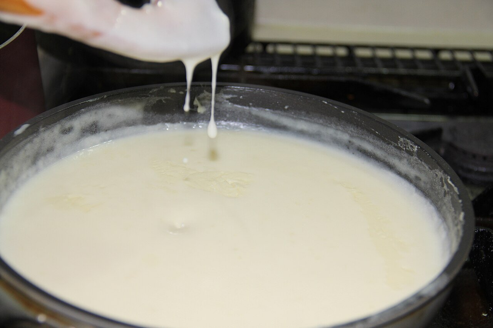

# Salsa velouté

*Foto: [Roozitaa](https://commons.wikimedia.org/wiki/File:Making_White_sauce_5.jpg), [CC BY-SA 3.0](https://creativecommons.org/licenses/by-sa/3.0/deed.es), vía Wikimedia Commons.*

Un roux blanco cocido con caldo claro de ave, de ternera o de pescado: la salsa madre francesa más ligera. En la foto, una salsa blanca al cocinarse.

🥄 Para **unos 500 ml** · ⏱️ 25 minutos · Dificultad: fácil

*In English:* [Velouté sauce](veloute.en.md)

## Ingredientes

- 40 g de mantequilla
- 40 g de harina
- 600 ml de caldo claro (de pollo, de ternera o de pescado), caliente
- Unas gotas de zumo de limón
- Sal y pimienta blanca

## Preparación

1. **El roux.** Funde la mantequilla a fuego medio-suave, añade la harina y cocínala 2–3 minutos removiendo, hasta que tome un color muy pálido.
2. **El caldo.** Añade el caldo caliente poco a poco, batiendo con varillas.
3. **Cocer.** Cuece a fuego suave 15 minutos, desespumando, hasta que napee la cuchara.
4. **Terminar.** Cuela, añade unas gotas de limón y salpimienta.

## Consejos

- **Con caldo de pescado** es la base de la salsa de vino blanco; con caldo de pollo, de la salsa suprema (con nata).
- **Con** pollo escalfado, pescado al vapor, vol-au-vent o verduras.
- **El caldo** es la clave: cuanto mejor sea, mejor la salsa.
