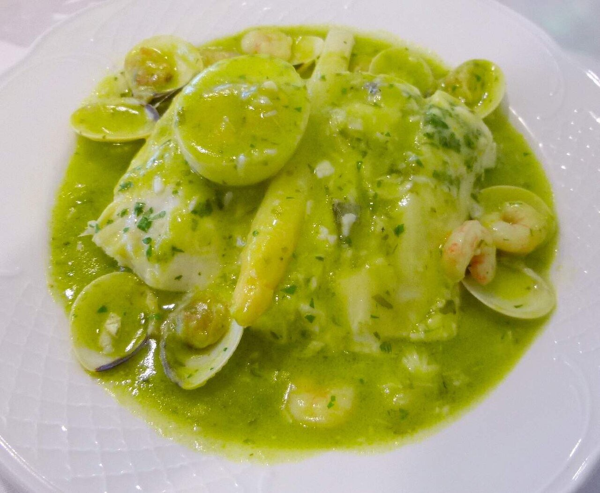

# Basque green parsley sauce

*Photo: [Zarateman](https://commons.wikimedia.org/wiki/File:Hernani_-_merluza_en_salsa_verde.jpg), [CC0](https://creativecommons.org/publicdomain/zero/1.0/), via Wikimedia Commons.*

The Basque sauce for hake: garlic, parsley, white wine and fish stock, bound with the fish's own gelatin.

🥄 Serves **4** · ⏱️ 25 minutes · Difficulty: medium

*En español:* [Salsa verde](verde.es.md)

## Ingredients

- 4 hake steaks or fillets (or cod)
- 3 garlic cloves
- 1 tablespoon all-purpose flour
- Scant ½ cup dry white wine
- 1 cup fish stock
- 1 large handful chopped parsley
- 10 oz clams (optional)
- 5 tablespoons olive oil
- Salt

## Directions

1. **Garlic.** In a wide pan, gently fry the minced garlic in the oil.
2. **Flour.** Stir in the flour for 1 minute without browning.
3. **Liquid.** Add the wine, let the alcohol cook off, then add the stock gradually.
4. **Fish.** Add the salted fish skin side up, plus the clams. Cook 4–5 minutes, swirling the pan so the sauce binds.
5. **Parsley.** Turn the fish, add the parsley and cook 1–2 more minutes.

## Tips

- **Koskera style:** add peas, white asparagus and hard-boiled egg.
- **Don't stir with a spoon:** swirl the pan so the fish stays whole.
- **Also great with** cod cheeks, monkfish or salt cod.
