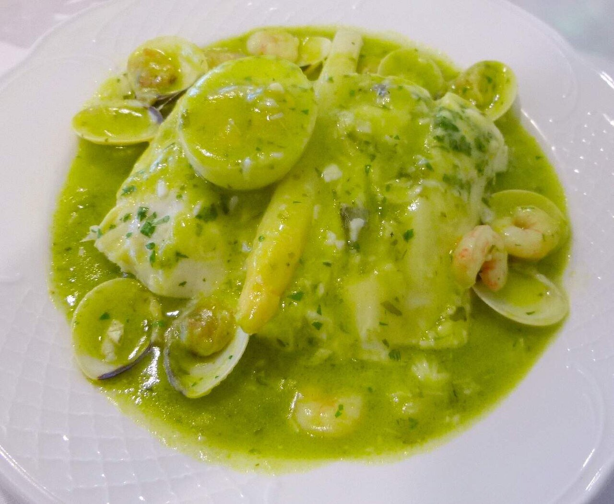

# Salsa verde

*Foto: [Zarateman](https://commons.wikimedia.org/wiki/File:Hernani_-_merluza_en_salsa_verde.jpg), [CC0](https://creativecommons.org/publicdomain/zero/1.0/deed.es), vía Wikimedia Commons.*

La salsa vasca de la merluza: ajo, perejil, vino blanco y fumet, ligada con la gelatina del pescado.

🥄 Para **4 personas** · ⏱️ 25 minutos · Dificultad: media

*In English:* [Basque green parsley sauce](verde.en.md)

## Ingredientes

- 4 rodajas o lomos de merluza
- 3 dientes de ajo
- 1 cucharada de harina
- 100 ml de vino blanco (o txakoli)
- 250 ml de fumet de pescado
- 1 buen puñado de perejil picado
- 300 g de almejas (opcional)
- 5 cucharadas de aceite de oliva
- Sal

## Preparación

1. **El ajo.** En una cazuela ancha, dora suavemente los ajos picados en el aceite.
2. **La harina.** Añade la harina y remueve 1 minuto sin que tome color.
3. **Mojar.** Añade el vino, deja que se evapore el alcohol y añade el fumet poco a poco.
4. **El pescado.** Mete la merluza salada con la piel hacia arriba y las almejas. Cuece 4–5 minutos moviendo la cazuela en vaivén para que la salsa ligue.
5. **El perejil.** Da la vuelta al pescado, añade el perejil y cuece 1–2 minutos más.

## Consejos

- **A la koskera:** añade guisantes, espárragos blancos y huevo cocido.
- **No remuevas con cuchara:** mueve la cazuela para no romper el pescado.
- **También con** kokotxas, rape o bacalao.
