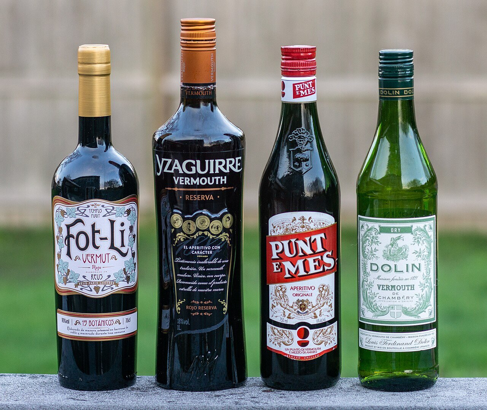

# Dry white vermouth sauce

*Photo: [Kenneth C. Zirkel](https://commons.wikimedia.org/wiki/File:Four_bottles_of_vermouth.jpg), [CC BY-SA 4.0](https://creativecommons.org/licenses/by-sa/4.0/), via Wikimedia Commons.*

Shallot, dry white vermouth, butter and parsley: a quick sauce for mussels, clams or white fish. The photo shows the vermouth, not the dish.

🥄 Serves **4** · ⏱️ 20 minutes · Difficulty: easy

*En español:* [Salsa al vermut blanco](vermut-blanco.es.md)

## Ingredients

- 2 shallots (or ½ onion)
- 2 garlic cloves
- ⅔ cup dry white vermouth
- Scant ½ cup heavy cream (optional)
- 2 tablespoons cold butter
- 1 tablespoon chopped parsley
- A few drops lemon juice
- 2 tablespoons olive oil
- Salt and white pepper

## Directions

1. **Base.** Gently cook the very finely chopped shallot and garlic in the oil for about 5 minutes.
2. **Vermouth.** Add the vermouth and reduce by half, about 5 minutes.
3. **With mussels or clams:** add them now, cover and cook over high heat until they open. Remove them and keep the sauce in the pan.
4. **Cream.** If using, add it and simmer 2 minutes.
5. **Mount.** Off the heat, whisk in the cold butter in cubes until glossy. Add the parsley, lemon, salt and pepper.

## Tips

- **Mussels in vermouth:** 3 lb cleaned mussels, with the sauce poured over.
- **For fish:** sear hake or cod and serve it on the sauce.
- **Use dry vermouth,** not sweet; if you only have sweet white vermouth, use less and add a splash of white wine.
