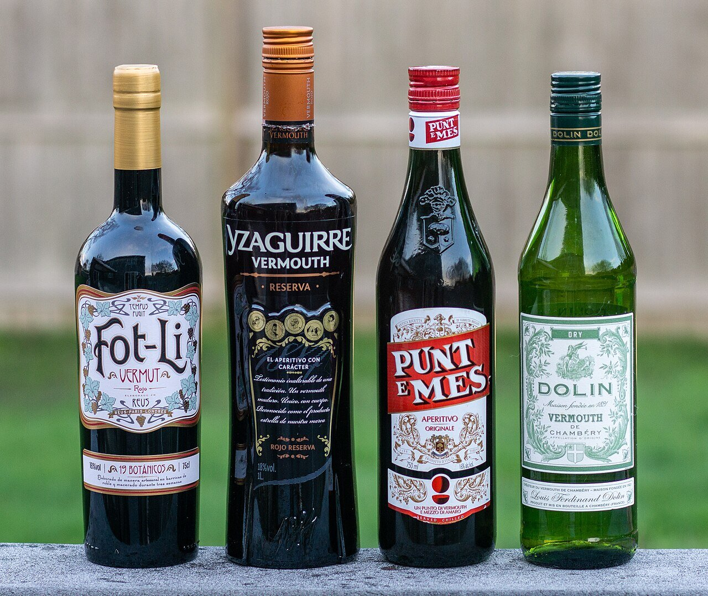

# Salsa al vermut blanco

*Foto: [Kenneth C. Zirkel](https://commons.wikimedia.org/wiki/File:Four_bottles_of_vermouth.jpg), [CC BY-SA 4.0](https://creativecommons.org/licenses/by-sa/4.0/deed.es), vía Wikimedia Commons.*

Chalota, vermut blanco seco, mantequilla y perejil: una salsa rápida para mejillones, almejas o pescado blanco. La foto muestra el vermut, no el plato.

🥄 Para **4 personas** · ⏱️ 20 minutos · Dificultad: fácil

*In English:* [Dry white vermouth sauce](vermut-blanco.en.md)

## Ingredientes

- 2 chalotas (o ½ cebolla)
- 2 dientes de ajo
- 150 ml de vermut blanco seco
- 100 ml de nata para cocinar (opcional)
- 30 g de mantequilla fría
- 1 cucharada de perejil picado
- Unas gotas de zumo de limón
- 2 cucharadas de aceite de oliva
- Sal y pimienta blanca

## Preparación

1. **El sofrito.** Pocha la chalota y el ajo picados muy finos en el aceite, a fuego suave, unos 5 minutos.
2. **El vermut.** Añade el vermut y deja reducir a la mitad, unos 5 minutos.
3. **Con mejillones o almejas:** añádelos ahora, tapa y cuece a fuego vivo hasta que se abran. Retíralos y deja la salsa en la cazuela.
4. **La nata.** Si la usas, añádela y cuece 2 minutos.
5. **Montar.** Fuera del fuego, añade la mantequilla fría en dados y remueve hasta que la salsa quede brillante. Añade el perejil, el limón, la sal y la pimienta.

## Consejos

- **Mejillones al vermut:** 1,5 kg de mejillones limpios, con la salsa por encima.
- **Para pescado:** cocina la merluza o el bacalao a la plancha y sírvela sobre la salsa.
- **Un vermut seco** y no dulce; si solo tienes vermut blanco dulce, pon menos y añade un chorrito de vino blanco.
