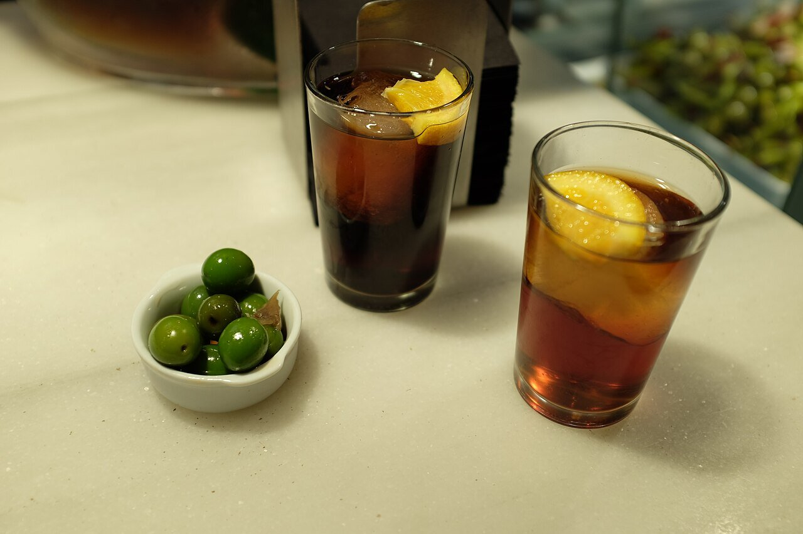

# Sweet red vermouth sauce

*Photo: [kerinin](https://commons.wikimedia.org/wiki/File:Vermut_de_Grifo.jpg), [CC BY-SA 2.0](https://creativecommons.org/licenses/by-sa/2.0/), via Wikimedia Commons.*

Onion, red vermouth and stock reduced with a hint of orange: a sauce for pork tenderloin, meatballs or chicken. The photo shows the vermouth, not the dish.

🥄 Serves **4** · ⏱️ 25 minutes · Difficulty: easy

*En español:* [Salsa al vermut rojo](vermut-rojo.es.md)

## Ingredients

- 1 onion
- 1 garlic clove
- ⅔ cup sweet red vermouth
- ¾ cup plus 1 tablespoon beef or chicken stock
- 1 strip orange zest (no white pith)
- 1 thyme or rosemary sprig
- 1 teaspoon cornstarch (optional)
- 1½ tablespoons butter
- 2 tablespoons olive oil
- Salt and pepper

## Directions

1. **Base.** Gently cook the chopped onion and garlic in the oil for about 10 minutes, until golden.
2. **Vermouth.** Pour in the vermouth, add the orange zest and thyme and reduce by half.
3. **Stock.** Add the stock and simmer 8–10 minutes until it reduces by half again.
4. **Thicken.** For a thicker sauce, stir in the cornstarch mixed with a little cold water and simmer 1 minute. Remove the zest and herbs.
5. **Finish.** Off the heat, stir in the butter. Season with salt and pepper. Blend it if you want it smooth.

## Tips

- **Pork tenderloin in vermouth:** sear the tenderloin, make the sauce in the same pan and finish the meat in it for 5 minutes.
- **Also with** meatballs, chicken, mushrooms or roasted chestnuts.
- **Balance the sweetness** with a splash of sherry vinegar if the vermouth is very sweet.
