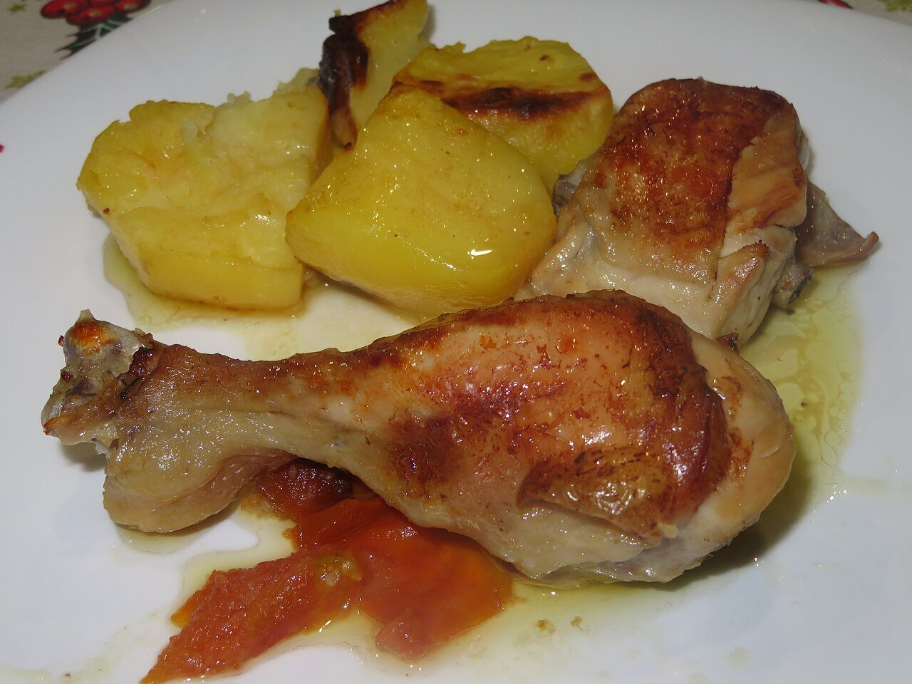

# Spanish white wine sauce

*Photo: [Juan Emilio Prades Bel](https://commons.wikimedia.org/wiki/File:Pollo_cocinado_al_horno_con_patatas,_rodajas_de_tomate,_vino_blanco_y_vinagre_(Espa%C3%B1a).jpg), [CC BY-SA 4.0](https://creativecommons.org/licenses/by-sa/4.0/), via Wikimedia Commons.*

Onion, garlic, white wine and stock, reduced and thickened with a little flour: a simple sauce for chicken, pork or fish.

🥄 Serves **4** · ⏱️ 25 minutes · Difficulty: easy

*En español:* [Salsa al vino blanco](vino-blanco.es.md)

## Ingredients

- 1 onion
- 2 garlic cloves
- 1 tablespoon all-purpose flour
- ¾ cup plus 1 tablespoon dry white wine
- ¾ cup plus 1 tablespoon stock (chicken or fish, to match the dish)
- 1 bay leaf
- 1 tablespoon chopped parsley
- 4 tablespoons olive oil
- Salt and pepper

## Directions

1. **Base.** Gently cook the chopped onion and garlic in the oil for about 10 minutes.
2. **Flour.** Stir in the flour for 1 minute without browning.
3. **Wine.** Pour in the wine, raise the heat and reduce by half, stirring.
4. **Stock.** Add the stock and bay leaf and simmer 8–10 minutes until thickened.
5. **Finish.** Remove the bay leaf, add the parsley and season with salt and pepper. Blend it for a smooth sauce.

## Tips

- **Chicken in white wine:** brown cut-up chicken first and simmer it 30–40 minutes in the sauce. It also works in the oven, with potatoes and tomato, basted with the wine.
- **For fish:** use fish stock and add clams or shrimp at the end.
- **Use a dry wine** you'd actually drink, never one that's gone sour.
