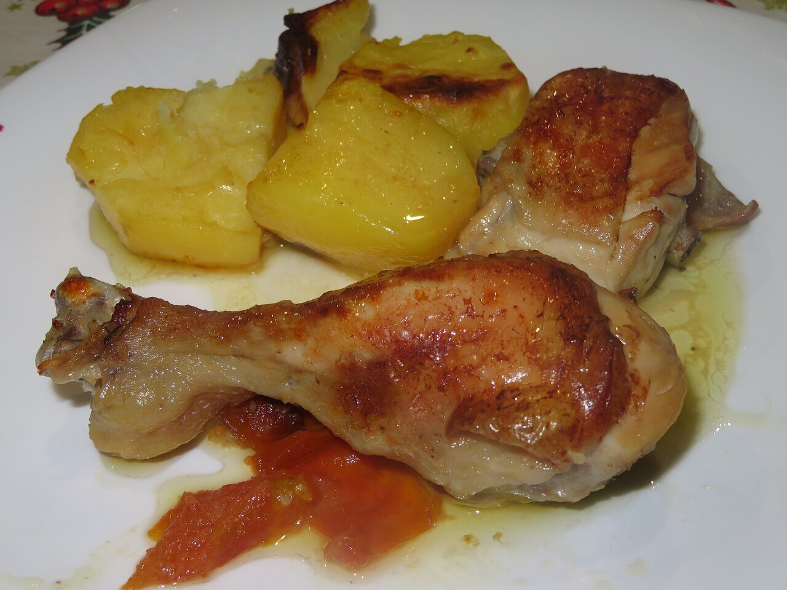

# Salsa al vino blanco

*Foto: [Juan Emilio Prades Bel](https://commons.wikimedia.org/wiki/File:Pollo_cocinado_al_horno_con_patatas,_rodajas_de_tomate,_vino_blanco_y_vinagre_(Espa%C3%B1a).jpg), [CC BY-SA 4.0](https://creativecommons.org/licenses/by-sa/4.0/deed.es), vía Wikimedia Commons.*

Cebolla, ajo, vino blanco y caldo reducidos y ligados con un poco de harina: una salsa sencilla para pollo, cerdo o pescado.

🥄 Para **4 personas** · ⏱️ 25 minutos · Dificultad: fácil

*In English:* [Spanish white wine sauce](vino-blanco.en.md)

## Ingredientes

- 1 cebolla
- 2 dientes de ajo
- 1 cucharada de harina
- 200 ml de vino blanco seco
- 200 ml de caldo (de pollo o de pescado, según el plato)
- 1 hoja de laurel
- 1 cucharada de perejil picado
- 4 cucharadas de aceite de oliva
- Sal y pimienta

## Preparación

1. **El sofrito.** Pocha la cebolla y el ajo picados en el aceite a fuego suave unos 10 minutos.
2. **La harina.** Añade la harina y remueve 1 minuto sin que tome color.
3. **El vino.** Moja con el vino, sube el fuego y deja reducir a la mitad, removiendo.
4. **El caldo.** Añade el caldo y el laurel y cuece 8–10 minutos hasta que la salsa espese.
5. **Terminar.** Retira el laurel, añade el perejil y ajusta de sal y pimienta. Tritúrala si la quieres fina.

## Consejos

- **Pollo al vino blanco:** dora el pollo troceado antes y guísalo 30–40 minutos en la salsa. También se hace al horno, con patatas y tomate, regado con el vino.
- **Para pescado:** usa fumet y añade almejas o gambas al final.
- **Un vino seco** que también te beberías; nunca uno avinagrado.
