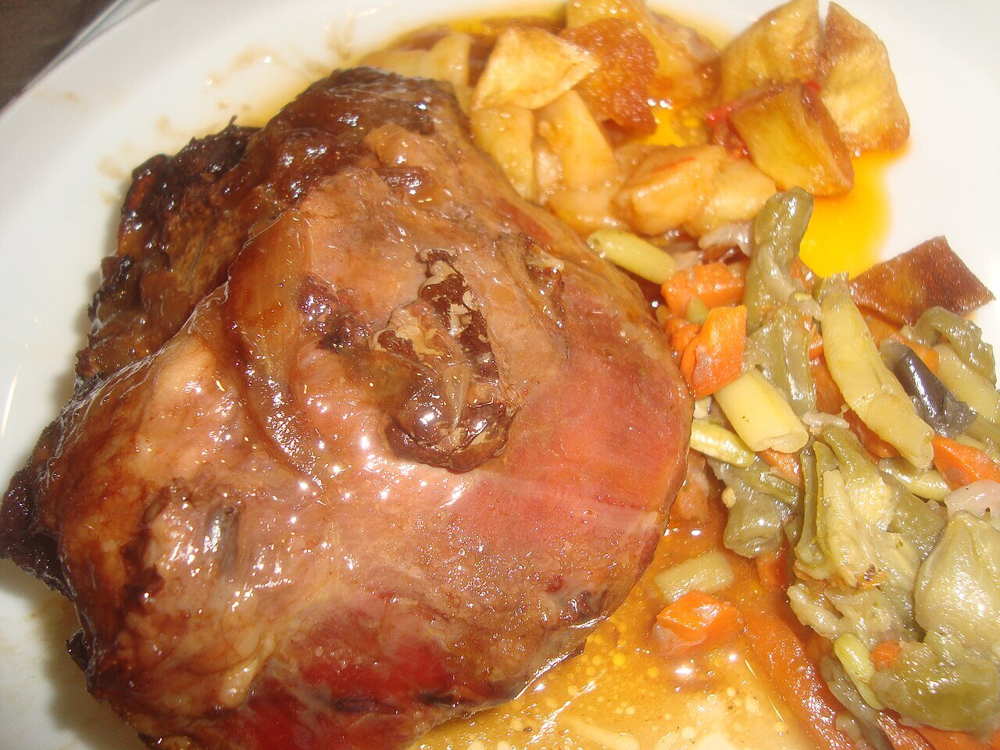

# Spanish red wine braising sauce

*Photo: [Juan Emilio Prades Bel](https://commons.wikimedia.org/wiki/File:Carrillada_de_cerdo_al_horno.jpg), [CC BY-SA 4.0](https://creativecommons.org/licenses/by-sa/4.0/), via Wikimedia Commons.*

Vegetables, red wine and stock slowly braised with the meat and then blended: the sauce for Spanish braised cheeks, oxtail and stews.

🥄 Serves **4** · ⏱️ 3 hours · Difficulty: medium

*En español:* [Salsa al vino tinto](vino-tinto.es.md)

## Ingredients

- 2¼ lb pork or beef cheeks (or oxtail, or stew meat)
- 1 onion
- 1 carrot
- 1 leek
- 2 garlic cloves
- 1 tablespoon tomato paste
- 2 cups dry red wine (Rioja, Ribera del Duero or similar)
- 1¼ cups beef stock
- 2 bay leaves and 1 thyme sprig
- All-purpose flour, for dredging
- 5 tablespoons olive oil
- Salt and pepper

## Directions

1. **Brown.** Season and dredge the meat in flour, brown it well in the oil and set aside.
2. **Vegetables.** In the same pot, gently cook the chopped onion, carrot, leek and garlic for about 15 minutes.
3. **Wine.** Stir in the tomato paste for 1 minute, then pour in the wine. Reduce over high heat for 5 minutes.
4. **Braise.** Return the meat, add the stock and herbs, cover and cook over very low heat for 2 h 30 min (beef cheeks) or 1 h 30 min (pork), until very tender.
5. **Sauce.** Lift out the meat, remove the herbs, then blend and strain the sauce. If it's thin, reduce it over high heat. Return the meat.

## Tips

- **In a pressure cooker:** about 45 minutes for beef.
- **Even better the next day:** skim the fat once it's cold.
- **Serve with** mashed potatoes, fries or white rice.
