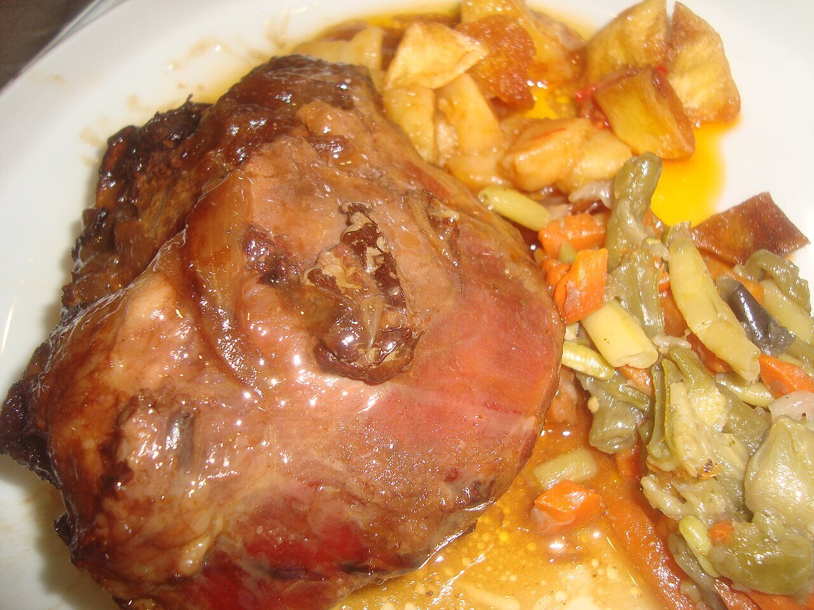

# Salsa al vino tinto

*Foto: [Juan Emilio Prades Bel](https://commons.wikimedia.org/wiki/File:Carrillada_de_cerdo_al_horno.jpg), [CC BY-SA 4.0](https://creativecommons.org/licenses/by-sa/4.0/deed.es), vía Wikimedia Commons.*

Verduras, vino tinto y caldo guisados despacio con la carne y luego triturados: la salsa de las carrilleras, el rabo y los estofados.

🥄 Para **4 personas** · ⏱️ 3 horas · Dificultad: media

*In English:* [Spanish red wine braising sauce](vino-tinto.en.md)

## Ingredientes

- 1 kg de carrilleras de cerdo o de ternera (o rabo, o carne de guisar)
- 1 cebolla
- 1 zanahoria
- 1 puerro
- 2 dientes de ajo
- 1 cucharada de tomate concentrado
- 500 ml de vino tinto (Rioja, Ribera o similar)
- 300 ml de caldo de carne
- 2 hojas de laurel y 1 ramita de tomillo
- Harina, para enharinar
- 5 cucharadas de aceite de oliva
- Sal y pimienta

## Preparación

1. **Dorar.** Salpimienta y enharina la carne, dórala bien en el aceite y retírala.
2. **Las verduras.** En la misma cazuela, pocha la cebolla, la zanahoria, el puerro y el ajo picados unos 15 minutos.
3. **El vino.** Añade el tomate concentrado, remueve 1 minuto y moja con el vino. Deja reducir a fuego vivo 5 minutos.
4. **Guisar.** Vuelve a meter la carne, añade el caldo y las hierbas, tapa y cuece a fuego muy suave 2 h 30 min (carrilleras de ternera) o 1 h 30 min (de cerdo), hasta que esté muy tierna.
5. **La salsa.** Saca la carne, retira las hierbas y tritura y cuela la salsa. Si está líquida, redúcela a fuego vivo. Vuelve a meter la carne.

## Consejos

- **Con olla exprés:** unos 45 minutos para la ternera.
- **Mejor de un día para otro:** desgrasa la salsa en frío.
- **Con** puré de patata, patatas fritas o arroz blanco.
