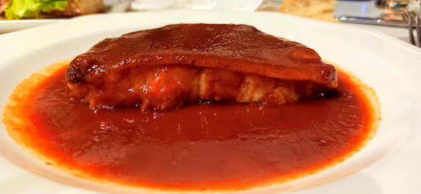

# Biscay-style red pepper and onion sauce

*Photo: [Gaztarrotz](https://commons.wikimedia.org/wiki/File:Bizkaitar_saltsa.jpg), [CC BY-SA 4.0](https://creativecommons.org/licenses/by-sa/4.0/), via Wikimedia Commons.*

The sauce from Biscay: lots of slowly cooked red onion and dried choricero peppers. The traditional recipe has no tomato.

🥄 Serves **4** · ⏱️ 1 h 30 min · Difficulty: medium

*En español:* [Salsa vizcaína](vizcaina.es.md)

## Ingredients

- 10 dried choricero peppers (or dried ancho chiles)
- 3 large red onions
- 2 garlic cloves
- 1 slice bread (optional)
- Scant ½ cup olive oil
- 1 cup stock (fish stock or the pepper soaking water)
- Salt

## Directions

1. **Dried peppers.** Stem and seed them and soak in hot water for 1 hour. Scrape out the flesh and save the water.
2. **Soften.** Chop the onion and garlic and cook, covered, over very low heat for 45–60 minutes, until very soft and sweet but not browned.
3. **Bread.** If using, add it torn at the end.
4. **Simmer.** Add the pepper flesh and stock and simmer 15 minutes.
5. **Blend.** Blend and pass through a food mill or strainer. Adjust salt and thickness.

## Tips

- **Biscay-style salt cod:** gently poach desalted cod fillets in oil and finish them 5 minutes in the sauce.
- **Also with** tripe, squid or eggs.
- **Freezes** very well.
