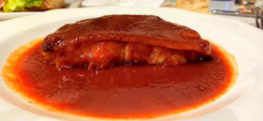

# Salsa vizcaína

*Foto: [Gaztarrotz](https://commons.wikimedia.org/wiki/File:Bizkaitar_saltsa.jpg), [CC BY-SA 4.0](https://creativecommons.org/licenses/by-sa/4.0/deed.es), vía Wikimedia Commons.*

La salsa de Bizkaia: mucha cebolla roja pochada y pimiento choricero. La receta tradicional no lleva tomate.

🥄 Para **4 personas** · ⏱️ 1 h 30 min · Dificultad: media

*In English:* [Biscay-style red pepper and onion sauce](vizcaina.en.md)

## Ingredientes

- 10 pimientos choriceros secos
- 3 cebollas rojas grandes
- 2 dientes de ajo
- 1 rebanada de pan (opcional)
- 100 ml de aceite de oliva
- 250 ml de caldo (de pescado o el agua de los choriceros)
- Sal

## Preparación

1. **Los choriceros.** Quítales el tallo y las semillas y remójalos en agua caliente 1 hora. Raspa la carne y guarda el agua.
2. **Pochar.** Pica la cebolla y el ajo y pocha a fuego muy suave, tapado, 45–60 minutos, hasta que estén muy blandos y dulces, sin dorarse.
3. **El pan.** Si lo usas, añádelo troceado al final del pochado.
4. **Cocer.** Añade la carne de choricero y el caldo y cuece 15 minutos.
5. **Triturar.** Tritura y pasa por el pasapurés o el colador. Ajusta de sal y de espesor.

## Consejos

- **Bacalao a la vizcaína:** confita los lomos de bacalao desalado y termínalos 5 minutos en la salsa.
- **Con** callos, tripa, chipirones o huevos.
- **Se congela** muy bien.
