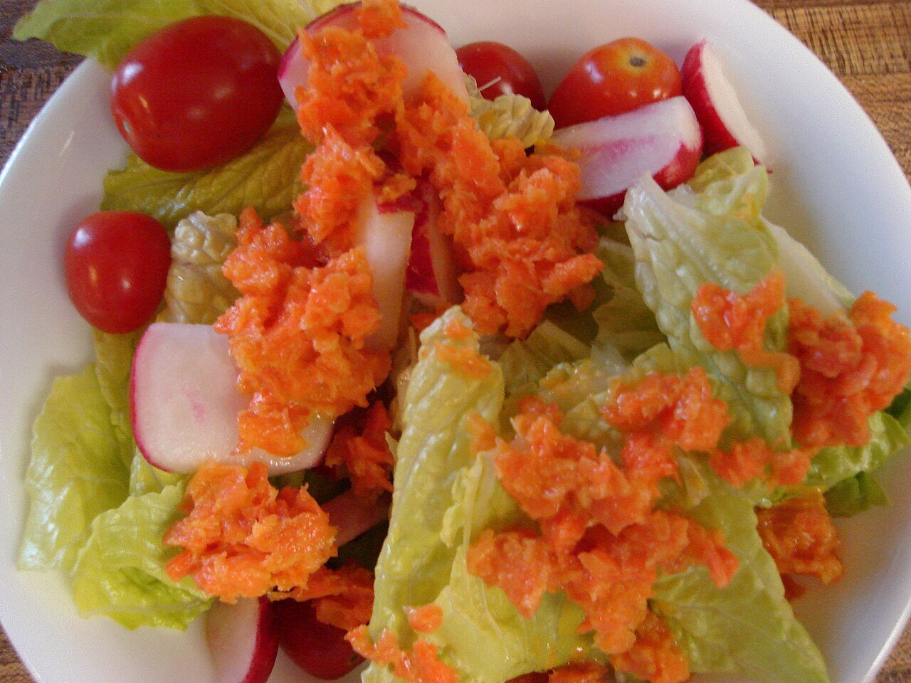

# Japanese soy and sesame dressing

*Photo: [Kari Sullivan from Austin, TX](https://commons.wikimedia.org/wiki/File:Vegan_Salad_with_Japanese_Carrot_Dressing_(124482297).jpg), [CC BY 2.0](https://creativecommons.org/licenses/by/2.0/), via Wikimedia Commons.*

Soy sauce, rice vinegar, sesame oil and grated onion: the Japanese salad dressing, vegan, with no alcohol and no peppers. The photo shows a salad with a Japanese carrot dressing.

🥄 Makes **about ⅔ cup** · ⏱️ 5 minutes · Difficulty: easy

*En español:* [Aliño wafu (vinagreta japonesa)](wafu.es.md)

## Ingredients

- 3 tablespoons soy sauce
- 3 tablespoons rice vinegar
- 1 tablespoon toasted sesame oil
- 3 tablespoons sunflower oil
- 1 teaspoon sugar
- 1 tablespoon grated onion
- 1 teaspoon toasted sesame seeds

## Directions

1. **Dissolve.** In a jar, stir the soy sauce, vinegar and sugar until dissolved.
2. **Onion.** Add the grated onion with its juice.
3. **Emulsify.** Add both oils and the sesame seeds, close the jar and shake hard.
4. **Serve.** Shake again just before dressing.

## Tips

- **Use on** salads of lettuce, cucumber, tomato, seaweed, tofu or cold noodles.
- **Carrot version:** add ½ grated carrot and 1 teaspoon ginger and blend.
- **Keeps** a week in the fridge.
