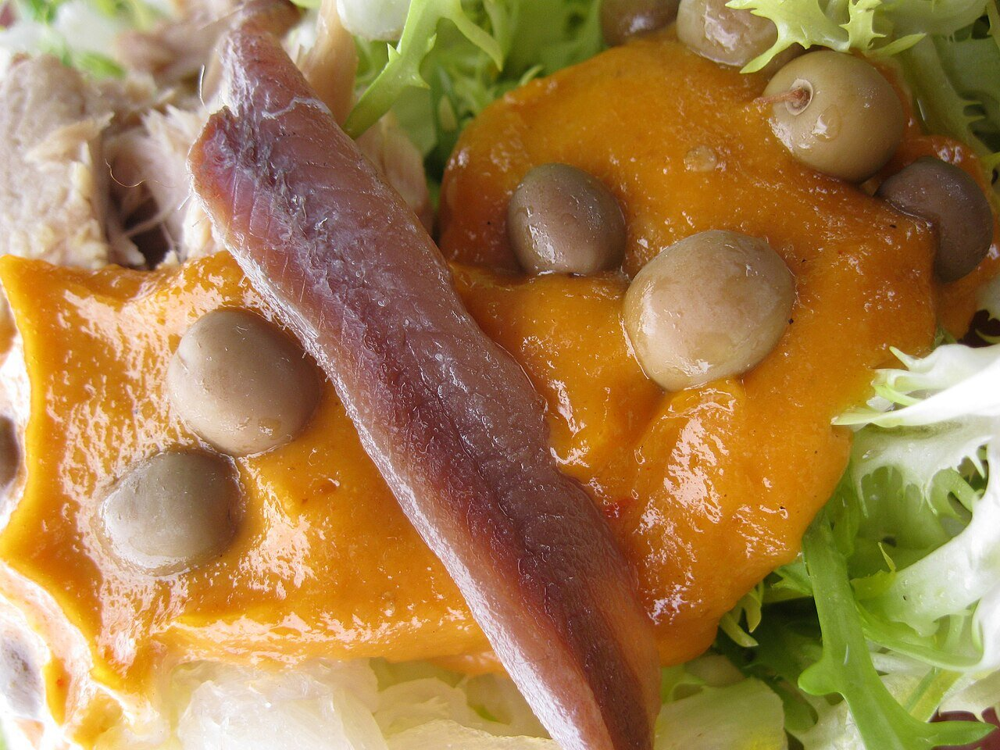

# Catalan dried pepper and nut dressing

*Photo: [Van Reubejn](https://commons.wikimedia.org/wiki/File:El_Xat%C3%B3_2012.jpg), [CC BY-SA 4.0](https://creativecommons.org/licenses/by-sa/4.0/), via Wikimedia Commons.*

The dressing for xató, the endive salad from Penedès and Garraf: dried ñora peppers, toasted nuts, garlic, bread, olive oil and vinegar.

🥄 Serves **4** · ⏱️ 40 minutes · Difficulty: medium

*En español:* [Salsa de xató (salvitxada)](xato.es.md)

## Ingredients

- 4 dried ñora peppers (or dried ancho chiles)
- 20 toasted almonds
- 10 toasted hazelnuts
- 4 garlic cloves (2 roasted, 2 raw)
- 1 roasted tomato (optional)
- 1 slice toasted bread
- ⅔ cup olive oil
- 2 tablespoons wine vinegar
- Salt

## Directions

1. **Dried peppers.** Seed them, soak 30 minutes in hot water and scrape out the flesh.
2. **Pound.** In a mortar, crush the garlic with the salt and nuts into a paste.
3. **Body.** Add the pepper flesh, the bread soaked in the vinegar and the roasted tomato, if using.
4. **Emulsify.** Stream in the oil, stirring constantly, until you have a thick sauce.

## Tips

- **For xató salad:** curly endive, shredded desalted cod, tuna, anchovies and Arbequina olives, tossed with this dressing.
- **Every town** has its own version: Vilanova, Sitges, El Vendrell…
- **Similar to romesco,** but lighter and tangier.
