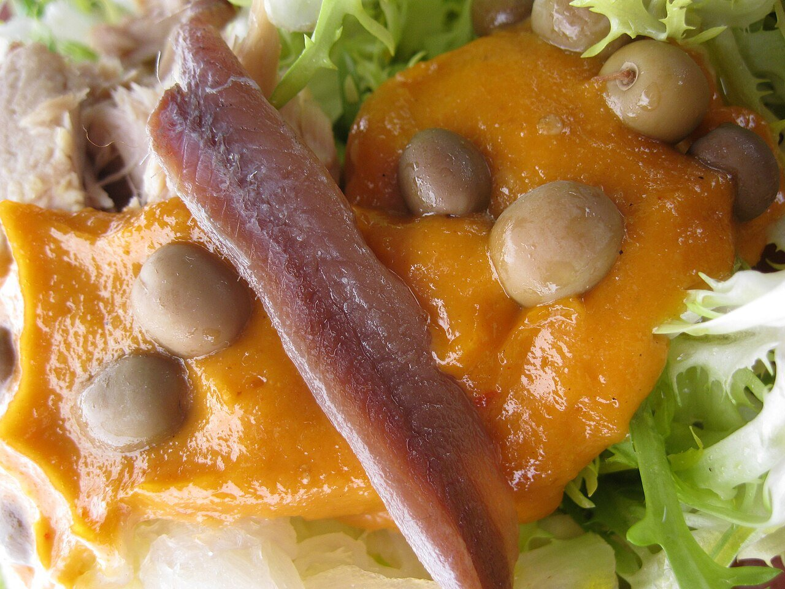

# Salsa de xató (salvitxada)

*Foto: [Van Reubejn](https://commons.wikimedia.org/wiki/File:El_Xat%C3%B3_2012.jpg), [CC BY-SA 4.0](https://creativecommons.org/licenses/by-sa/4.0/deed.es), vía Wikimedia Commons.*

La salsa del xató, la ensalada de escarola del Penedès y el Garraf: ñoras, frutos secos tostados, ajo, pan, aceite y vinagre.

🥄 Para **4 personas** · ⏱️ 40 minutos · Dificultad: media

*In English:* [Catalan dried pepper and nut dressing](xato.en.md)

## Ingredientes

- 4 ñoras
- 20 almendras tostadas
- 10 avellanas tostadas
- 4 dientes de ajo (2 asados y 2 crudos)
- 1 tomate asado (opcional)
- 1 rebanada de pan tostado
- 150 ml de aceite de oliva
- 2 cucharadas de vinagre de vino
- Sal

## Preparación

1. **Las ñoras.** Quítales las semillas, remójalas 30 minutos en agua caliente y raspa la carne.
2. **Machacar.** En el mortero, machaca los ajos con la sal y los frutos secos hasta tener una pasta.
3. **Más cuerpo.** Añade la carne de ñora, el pan remojado en el vinagre y el tomate asado, si lo usas.
4. **Ligar.** Añade el aceite en un hilo sin dejar de remover hasta que quede una salsa espesa.

## Consejos

- **El xató:** escarola, bacalao desalado desmigado, atún, anchoas y aceitunas arbequinas, aliñados con esta salsa.
- **Cada pueblo** tiene su versión: Vilanova, Sitges, el Vendrell…
- **Parecida al romesco,** pero más ligera y con más vinagre.
