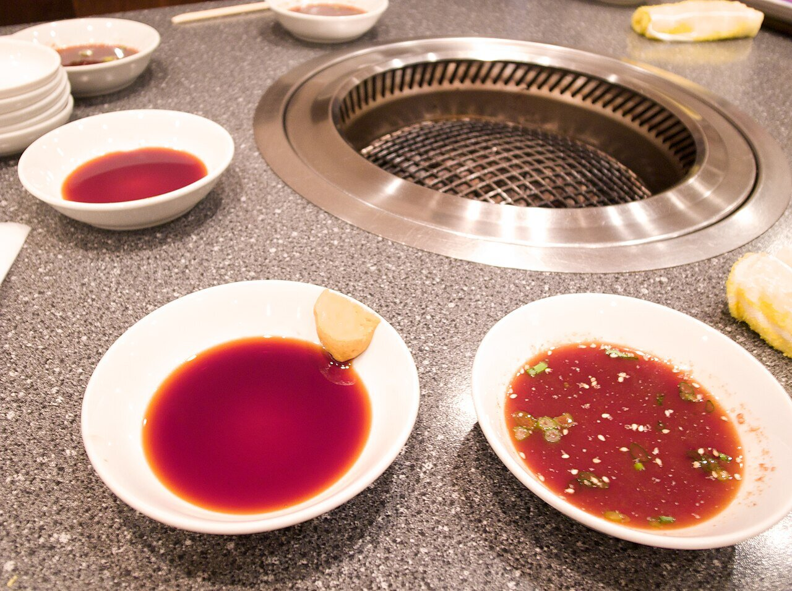

# Japanese barbecue sauce

*Photo: [whity](https://commons.wikimedia.org/wiki/File:Yakiniku_tare_(6524024799).jpg), [CC BY 2.0](https://creativecommons.org/licenses/by/2.0/), via Wikimedia Commons.*

Soy sauce, mirin, sake, sugar, garlic, ginger, grated apple, sesame oil and toasted sesame seeds: the sauce for Japanese grilled meat.

🥄 Makes **about 1 cup** · ⏱️ 15 minutes · Difficulty: easy

*En español:* [Salsa yakiniku (yakiniku no tare)](yakiniku.es.md)

## Ingredients

- Scant ½ cup soy sauce
- 2 tablespoons mirin
- 2 tablespoons sake
- 2 tablespoons sugar (or honey)
- ½ apple, grated (or ½ Asian pear)
- 1 garlic clove, grated
- 1 teaspoon grated ginger
- 1 tablespoon toasted sesame oil
- 1 tablespoon toasted white sesame seeds

## Directions

1. **Simmer.** In a small saucepan, bring the soy sauce, mirin, sake and sugar to a boil and cook 1–2 minutes, until the sugar dissolves and the alcohol cooks off.
2. **Flavor.** Turn off the heat and add the grated apple, garlic and ginger.
3. **Cool.** Let it cool slightly, then stir in the sesame oil and the lightly crushed sesame seeds.
4. **Rest.** Store in a jar in the fridge; it's better the next day.

## Tips

- **Use as a dip** for grilled meat or **as a marinade** for 30 minutes before grilling.
- **Serve with** beef, pork, chicken, mushrooms or grilled vegetables.
- **Alcohol-free:** replace the sake and mirin with water and 1 more tablespoon of sugar.
