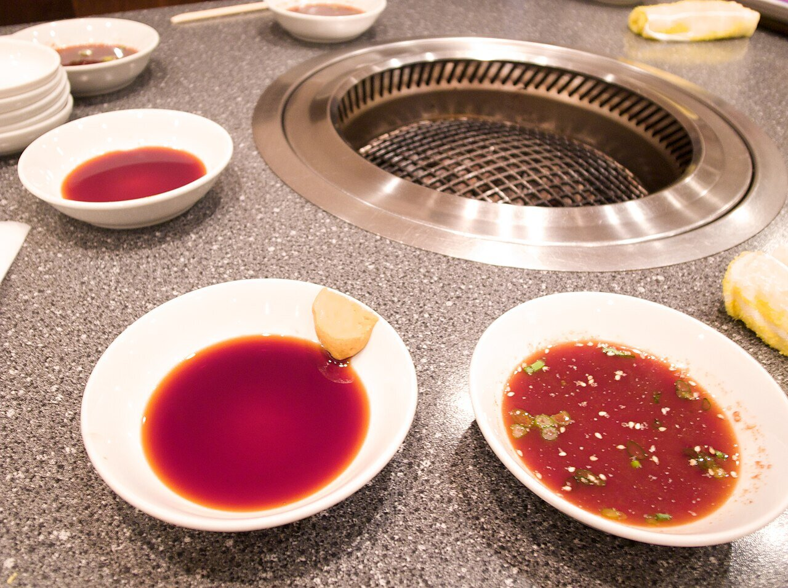

# Salsa yakiniku (yakiniku no tare)

*Foto: [whity](https://commons.wikimedia.org/wiki/File:Yakiniku_tare_(6524024799).jpg), [CC BY 2.0](https://creativecommons.org/licenses/by/2.0/deed.es), vía Wikimedia Commons.*

Salsa de soja, mirin, sake, azúcar, ajo, jengibre, manzana rallada, aceite de sésamo y sésamo tostado: la salsa de la carne a la parrilla japonesa.

🥄 Para **unos 250 ml** · ⏱️ 15 minutos · Dificultad: fácil

*In English:* [Japanese barbecue sauce](yakiniku.en.md)

## Ingredientes

- 100 ml de salsa de soja
- 2 cucharadas de mirin
- 2 cucharadas de sake
- 2 cucharadas de azúcar (o de miel)
- ½ manzana rallada (o ½ pera asiática)
- 1 diente de ajo rallado
- 1 cucharadita de jengibre rallado
- 1 cucharada de aceite de sésamo tostado
- 1 cucharada de sésamo blanco tostado

## Preparación

1. **Cocer.** En un cazo, lleva a ebullición la soja, el mirin, el sake y el azúcar y cuece 1–2 minutos, hasta que se disuelva el azúcar y se evapore el alcohol.
2. **Aromatizar.** Apaga el fuego y añade la manzana, el ajo y el jengibre rallados.
3. **Enfriar.** Deja templar y añade el aceite de sésamo y el sésamo, un poco machacado.
4. **Reposar.** Guárdala en un tarro en la nevera; está mejor al día siguiente.

## Consejos

- **Para mojar** la carne a la parrilla o **para marinar** 30 minutos antes de asarla.
- **Con** ternera, cerdo, pollo, setas o verduras a la plancha.
- **Sin alcohol:** cambia el sake y el mirin por agua y una cucharada más de azúcar.
